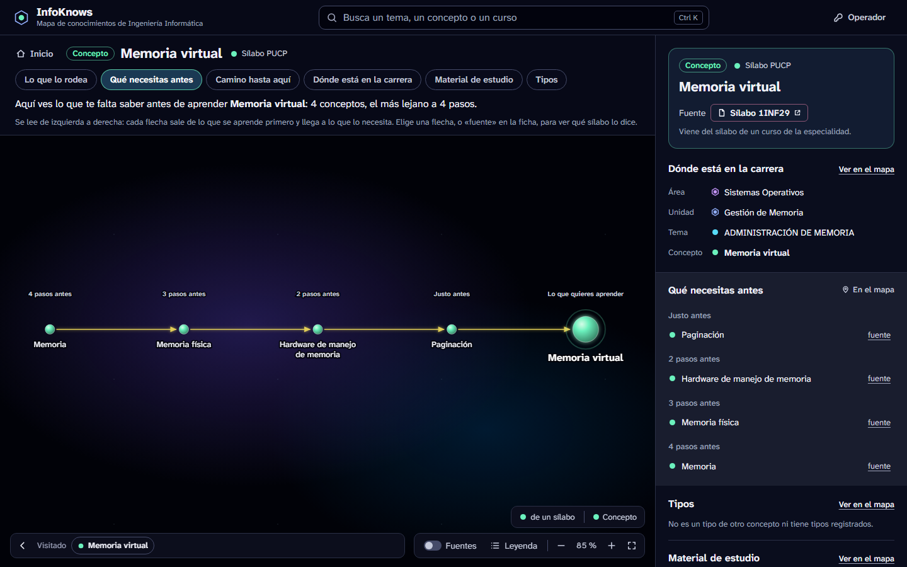
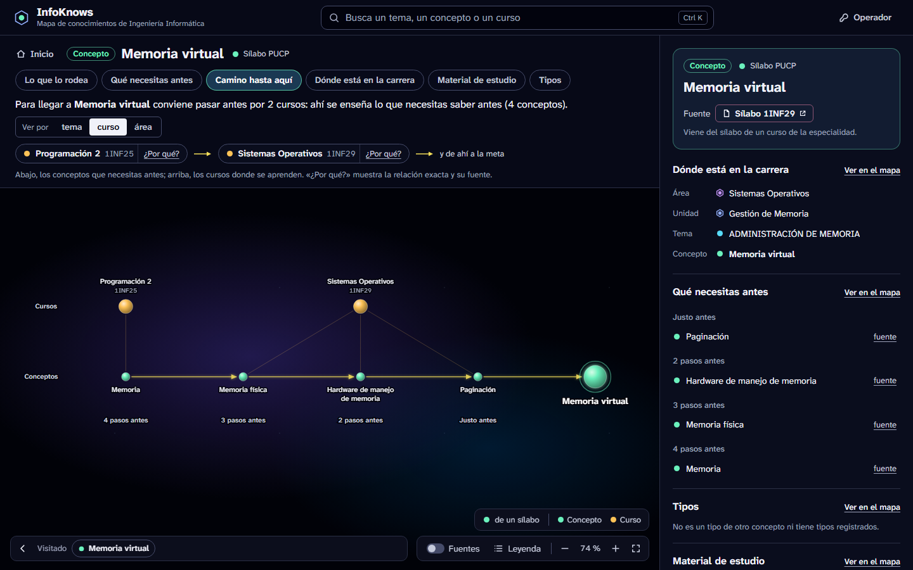
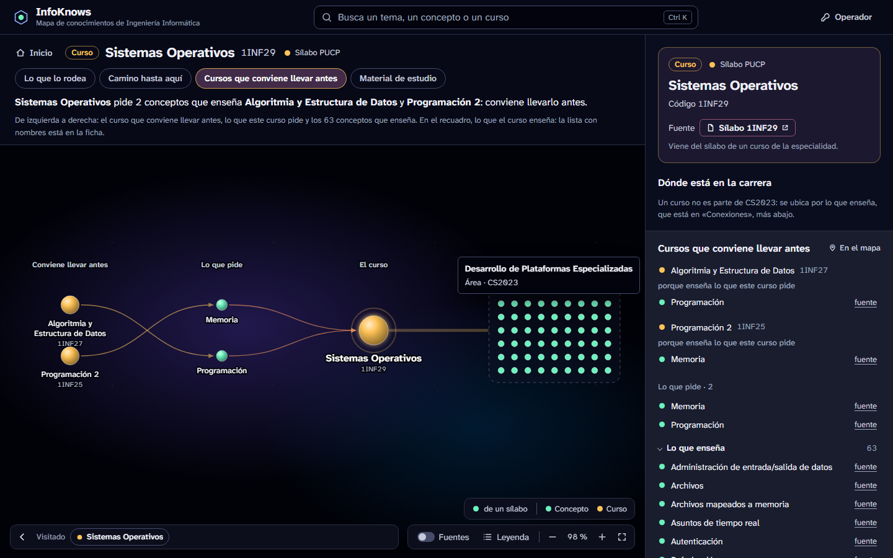
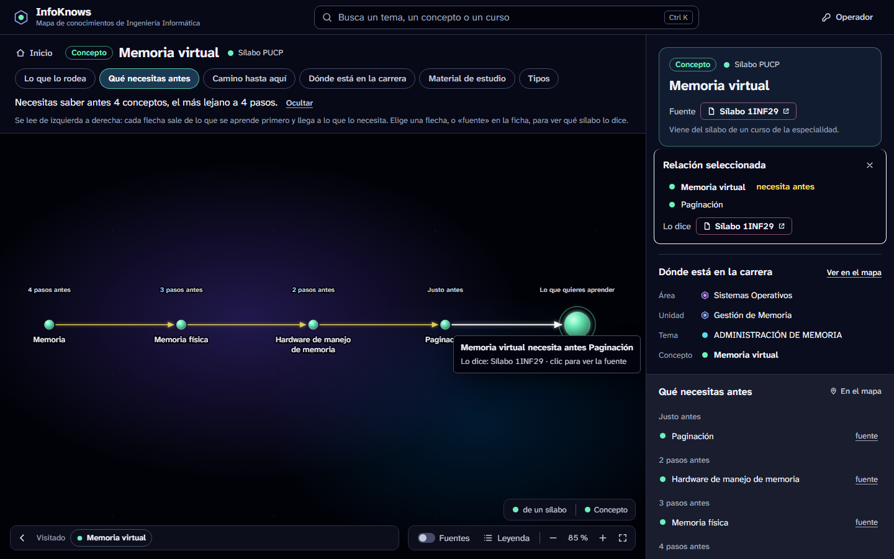
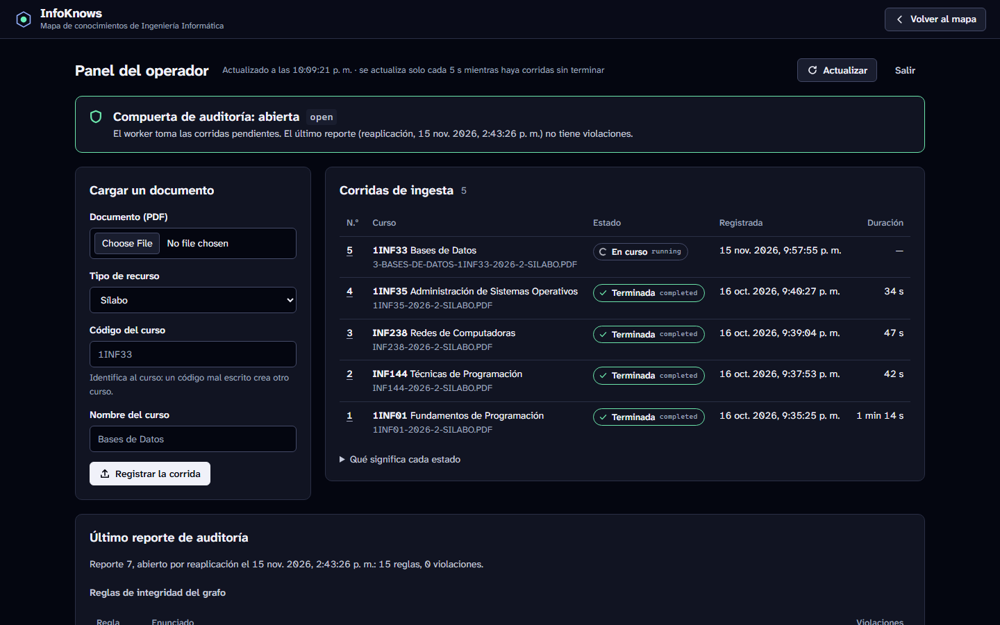
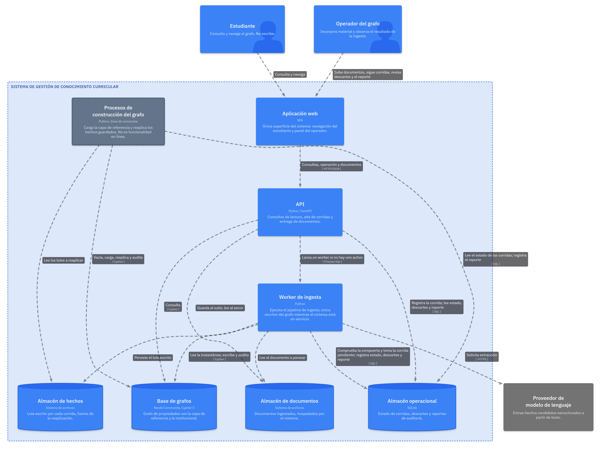

# InfoKnows

**El currículo de Ingeniería Informática de la PUCP como un grafo de
conocimiento que se puede navegar:** qué necesitas saber antes de un tema, qué
curso conviene llevar antes que otro, dónde encaja cada concepto en la carrera
y de qué sílabo sale cada afirmación.



Tesis de Ingeniería Informática de la Pontificia Universidad Católica del Perú.
Este repositorio contiene el módulo de grafo de conocimiento, su pipeline de
ingesta con modelo de lenguaje y la aplicación web InfoKnows.

## El problema

El plan de estudios dice qué curso va antes que otro, pero no qué **concepto**
hace falta para entender otro. Esa dependencia existe dentro de los sílabos,
repartida en trece PDF que nadie lee juntos. En una encuesta a 154 estudiantes
de la carrera, el 83,1 % pidió poder ver qué conceptos previos necesita antes
de un tema, y el 72,1 % pidió encontrar recursos de estudio sobre él.

InfoKnows parte de esos sílabos y del estándar internacional
[CS2023](https://csed.acm.org/) de ACM, IEEE-CS y AAAI, y los une en un solo
grafo que se recorre a nivel de concepto.

## Qué puedes hacer

| Pregunta | Lo que responde InfoKnows |
|---|---|
| ¿Qué necesito saber antes de este concepto? | Sus prerrequisitos, transitivos, ordenados por distancia |
| ¿Qué curso me conviene llevar antes? | Lo que el curso pide, qué curso lo enseña y por qué |
| ¿Cómo llego hasta esta meta? | El camino, agrupado por tema, por curso o por área |
| ¿Dónde está esto en la carrera? | La cadena área › unidad › tema › concepto |
| ¿Qué contiene este tema, y en qué orden lo aprendo? | Sus conceptos, en pasos según sus prerrequisitos |
| ¿Dónde estudio esto? | Los sílabos que lo tratan y por qué tema llega cada uno |
| ¿De dónde sale este dato? | El documento del que procede, que se abre con un clic |

| | |
|---|---|
|  |  |
| **El camino hasta una meta**, por curso | **Los cursos que conviene llevar antes**, con lo que piden y enseñan |
|  |  |
| **Cada relación con su fuente**: «Memoria virtual necesita antes Paginación» | **El panel del operador**: subir un sílabo y revisar su ingesta |

Todas las pantallas, con lo que muestra cada una, están en
[`docs/r6/`](docs/r6/README.md).

## Respuestas trazables, no plausibles

Un asistente de IA general puede contestar «qué necesito antes de memoria
virtual» con algo convincente que nadie puede verificar. InfoKnows separa a
quien propone de quien escribe:

- **El modelo de lenguaje propone, pero no escribe.** Lee cada sílabo y propone
  temas, conceptos y relaciones. Antes de entrar al grafo, cada hecho pasa por
  las reglas que se derivan de la ontología. Si una sola falla, se rechaza el
  documento entero y se guarda el motivo.
- **El grafo cumple lo que la ontología declara.** La ontología OWL del dominio,
  validada por un experto y por el razonador HermiT, se traduce a 15 reglas de
  integridad. Esas reglas se impiden al escribir y se vuelven a auditar sobre
  el grafo completo al cerrar cada escritura.
- **Toda afirmación institucional remite a su documento.** Cada tema, concepto
  y relación sabe de qué sílabo procede, y ese PDF se abre desde la interfaz.
- **El grafo se reconstruye sin volver a llamar al modelo.** Cada ingesta
  aceptada se guarda como un archivo de hechos. Si se corrige el backbone o se
  cambia de servidor, el grafo se rehace igual y sin costo.

## Resultados

La corrida final ingestó en cadena los 13 sílabos del semestre 2026-2 con
`gpt-6.1-sol`. Se midió contra una anotación de referencia de 744 entradas,
congelada antes de la medición. Dos de los sílabos quedaron fuera del ajuste
del prompt, para medir sin ese sesgo.

| Medida | Resultado |
|---|---|
| Precisión de entidades (indicador de R4, umbral 75 %) | **83,3 %** (533 de 640) |
| Exhaustividad de las nociones obligatorias | 85,1 % |
| F1 | 84,2 % |
| Precisión en los dos sílabos reservados | 78,8 % |
| Concordancia de tipo (tema o concepto) | 97,0 % |
| Sílabos aceptados en el primer intento | 13 de 13 |
| Fusiones erróneas entre sílabos | 0 |

El acierto exige que el nombre coincida con la anotación, así que una
extracción correcta con otra redacción cuenta como error. La precisión real es,
por tanto, al menos esa. Cómo se calcula cada medida:
[`casos-de-prueba/calculo-de-las-medidas-del-evaluador.md`](casos-de-prueba/calculo-de-las-medidas-del-evaluador.md).

El grafo resultante tiene **818 nodos y 2898 aristas**: las 17 áreas y las 162
unidades de conocimiento de CS2023, y los temas, conceptos y relaciones de los
13 cursos.

## Cómo está hecho

```
 13 sílabos PDF ──► Docling ──► modelo de lenguaje ──► reglas de la ontología ──► Neo4j ──► API ──► InfoKnows
                    (texto)     (propone hechos)       (aceptan o rechazan)      (grafo)  (FastAPI) (Svelte + D3)
                                                                │
                                                     archivo de hechos por corrida
                                                     (reconstrucción sin modelo)
```

| Capa | Tecnología |
|---|---|
| Ontología y backbone | OWL 2 y Turtle, validados con HermiT |
| Base de grafos | Neo4j 5.26 LTS Community |
| Ingesta | Python, Docling y PydanticAI, con salida estricta |
| API | FastAPI, documentada con OpenAPI |
| Aplicación web | Svelte 5, Vite y D3 en SVG, navegable solo con el teclado |
| Despliegue | Docker Compose: Neo4j, API con su worker, nginx; HTTPS con Caddy en AWS |

La arquitectura está documentada con el modelo C4 en
[`docs/architecture/`](docs/architecture/), y cada decisión, con las
alternativas que se descartaron, en los 19 ADR de
[`docs/decisiones/`](docs/decisiones/README.md).



## Probarlo

Requiere [Docker](https://www.docker.com/products/docker-desktop/) con Docker
Compose.

```powershell
cp .env.example .env               # pon una contraseña y un token del operador
docker compose up -d --build       # Neo4j, la API y la web
docker compose stop api
docker compose run --rm build load # carga CS2023 en el grafo
docker compose start api
```

InfoKnows queda en <http://localhost>. Con solo la carga se navega CS2023. La
capa de los sílabos se obtiene al ingestarlos desde el panel del operador, con
un proveedor de modelo de lenguaje configurado en `.env`, o al reaplicar un
almacén de hechos ya guardado.

Todo lo demás está en la **[guía de operación](docs/operacion.md)**: desarrollo
local, la API ruta por ruta, ingesta, reconstrucción, medición, pruebas y
configuración. El despliegue en AWS está en [`DEPLOYMENT.md`](DEPLOYMENT.md) y
el desarrollo de la web, en [`web/README.md`](web/README.md).

## Qué hay en el repositorio

| Resultado de la tesis | Dónde |
|---|---|
| R1 · Ontología OWL del dominio | [`ontology/ontologia_informatica.ttl`](ontology/ontologia_informatica.ttl) |
| R2 · Backbone CS2023: 17 áreas y 162 unidades | [`ontology/backbone_cs2023.ttl`](ontology/backbone_cs2023.ttl) |
| R3 · Documentación del módulo de grafo | [`docs/architecture/`](docs/architecture/), [`docs/decisiones/`](docs/decisiones/README.md) (ADR-001 a ADR-015), [`casos-de-prueba/`](casos-de-prueba/) |
| R4 · Módulo de grafo, ingesta y API | [`src/iekg/`](src/iekg/), [`tests/`](tests/) |
| R5 · Documentación de la navegación | [`docs/r5/`](docs/r5/README.md), ADR-016 a ADR-019 |
| R6 · InfoKnows, el prototipo de navegación | [`web/`](web/README.md), [`docs/r6/`](docs/r6/README.md) |

El documento de tesis está en [`docs/tesis.md`](docs/tesis.md).
